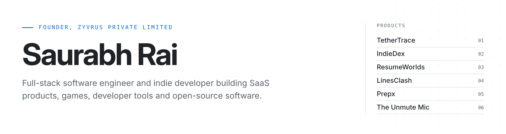
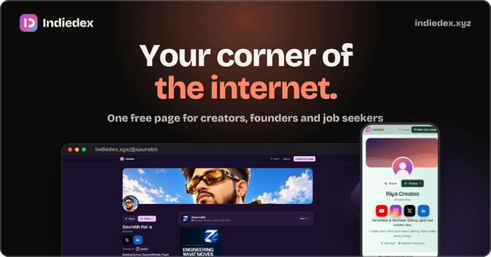
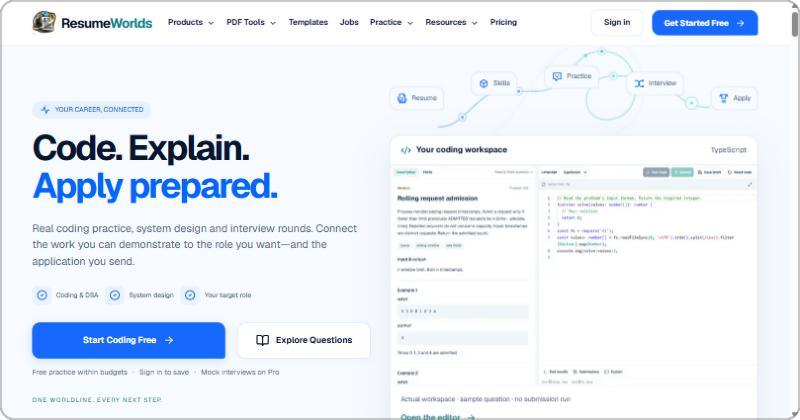
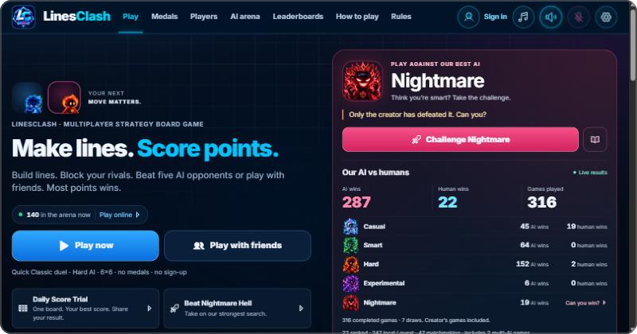
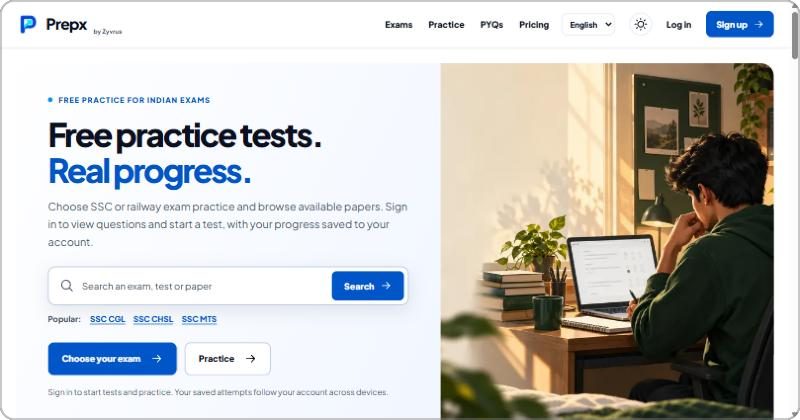
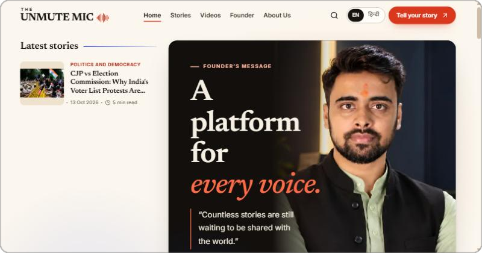
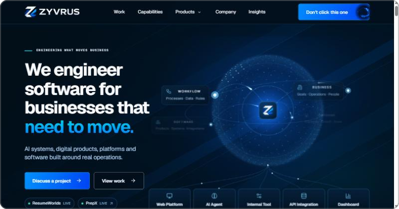

<a href="https://indiedex.xyz/@saurabh">
  <picture>
    <source media="(prefers-color-scheme: dark)" srcset="./assets/header-dark.png">
    <source media="(prefers-color-scheme: light)" srcset="./assets/header-light.png">
    
  </picture>
</a>

  <a href="https://indiedex.xyz/@saurabh"><b>Portfolio</b></a>
  &nbsp;&nbsp;&middot;&nbsp;&nbsp;
  <a href="https://www.zyvrus.com"><b>Zyvrus</b></a>
  &nbsp;&nbsp;&middot;&nbsp;&nbsp;
  <a href="https://linkedin.com/in/saurabh-rai08/"><b>LinkedIn</b></a>
  &nbsp;&nbsp;&middot;&nbsp;&nbsp;
  <a href="https://x.com/Keshurai25"><b>X</b></a>
  &nbsp;&nbsp;&middot;&nbsp;&nbsp;
  <a href="https://github.com/Saurabhzz9/tethertrace"><b>TetherTrace</b></a>

 

## About

I'm Saurabh Rai, founder of **[Zyvrus Private Limited](https://www.zyvrus.com)** and a full-stack software engineer. I design, build and ship products end to end: data models and APIs, interfaces, infrastructure and launch.

My work spans **SaaS products**, **games**, **developer tools** and **open-source software**, built with TypeScript, Go and Python across web, backend and cloud.

### Engineering philosophy

- **Ship complete products.** A working product in people's hands teaches more than any roadmap.
- **Treat the stack as one system.** Schema, API, interface and deployment are designed together, not handed off.
- **Keep the infrastructure boring.** Typed code, proven databases and simple architecture leave room for the product to be interesting.
- **Open source where it builds trust.** Developer tools should be inspectable, so I publish them openly.

 

## Featured Open Source

### [TetherTrace](https://github.com/Saurabhzz9/tethertrace)

Open-source Android testing toolkit over Wi-Fi, with MCP integration and automated testing.

  
  
  
  

- Installs and tests an Android app on a real phone over Wi-Fi by speaking the ADB protocol directly. No adb binary or Android SDK required.
- Explores app screens, catches crashes and freezes, and writes an HTML report with screenshots and logs.
- Runs YAML test flows from the command line, with optional screen recording.
- Includes an MCP server that gives AI clients such as Claude Code and Codex control of the phone: screenshots, UI tree, tap, type, install, logs and test runs.

**[GitHub Repository](https://github.com/Saurabhzz9/tethertrace)** &nbsp;&middot;&nbsp; **[Explore](https://github.com/Saurabhzz9/tethertrace#readme)**

 

## Featured Products

<table>
  <tr>
    <td width="50%" valign="top">
      
      <h3><a href="https://indiedex.xyz">IndieDex</a></h3>
      
<b>CREATOR PLATFORM</b> Creator identity, portfolios, discovery and a digital storefront platform.

      

        <a href="https://indiedex.xyz"><b>Live Website</b></a> &nbsp;&middot;&nbsp;
        <a href="https://indiedex.xyz/@saurabh"><b>My Profile</b></a> &nbsp;&middot;&nbsp;
        <a href="https://indiedex.xyz/guide"><b>Explore</b></a>
      

    </td>
    <td width="50%" valign="top">
      
      <h3><a href="https://resumeworlds.com">ResumeWorlds</a></h3>
      
<b>AI CAREER PLATFORM</b> AI-powered resume builder, ATS optimization, job matching and career tools.

      

        <a href="https://resumeworlds.com"><b>Live Website</b></a> &nbsp;&middot;&nbsp;
        <a href="https://www.resumeworlds.com/ats-checker"><b>Explore</b></a>
      

    </td>
  </tr>
  <tr>
    <td width="50%" valign="top">
      
      <h3><a href="https://linesclash.com">LinesClash</a></h3>
      
<b>MULTIPLAYER GAME</b> Multiplayer strategy grid game with advanced AI opponents.

      

        <a href="https://linesclash.com"><b>Live Website</b></a> &nbsp;&middot;&nbsp;
        <a href="https://linesclash.com/how-to-play"><b>Explore</b></a>
      

    </td>
    <td width="50%" valign="top">
      
      <h3><a href="https://prepx.zyvrus.com">Prepx</a></h3>
      
<b>EDTECH</b> Competitive examination preparation platform for Indian students.

      

        <a href="https://prepx.zyvrus.com"><b>Live Website</b></a> &nbsp;&middot;&nbsp;
        <a href="https://prepx.zyvrus.com/exams"><b>Explore</b></a>
      

    </td>
  </tr>
  <tr>
    <td width="50%" valign="top">
      
      <h3><a href="https://theunmutemic.com">The Unmute Mic</a></h3>
      
<b>DIGITAL PUBLISHING</b> Independent storytelling and publishing platform.

      

        <a href="https://theunmutemic.com"><b>Live Website</b></a> &nbsp;&middot;&nbsp;
        <a href="https://www.theunmutemic.com/stories"><b>Explore</b></a>
      

    </td>
    <td width="50%" valign="top">
      
      <h3><a href="https://www.zyvrus.com">Zyvrus Private Limited</a></h3>
      
<b>THE COMPANY</b> Software engineering company building SaaS products, AI systems and platforms.

      

        <a href="https://www.zyvrus.com"><b>Live Website</b></a> &nbsp;&middot;&nbsp;
        <a href="https://www.zyvrus.com/work"><b>Explore</b></a>
      

    </td>
  </tr>
</table>

 

## Tech Stack

<table>
  <tr>
    <td width="150"><b>Languages</b></td>
    <td>
      
      
      
      
    </td>
  </tr>
  <tr>
    <td width="150"><b>Frontend</b></td>
    <td>
      
      
      
    </td>
  </tr>
  <tr>
    <td width="150"><b>Backend</b></td>
    <td>
      
      
    </td>
  </tr>
  <tr>
    <td width="150"><b>Data</b></td>
    <td>
      
      
      
    </td>
  </tr>
  <tr>
    <td width="150"><b>Cloud &amp; DevOps</b></td>
    <td>
      
      
      
    </td>
  </tr>
</table>

 

## GitHub Activity

<picture>
  <source media="(prefers-color-scheme: dark)" srcset="https://streak-stats.demolab.com/?user=Saurabhzz9&hide_border=true&disable_animations=true&background=0D1117&ring=4493F8&fire=4493F8&currStreakNum=F0F6FC&sideNums=F0F6FC&currStreakLabel=4493F8&sideLabels=9198A1&dates=9198A1&stroke=30363D">
  <source media="(prefers-color-scheme: light)" srcset="https://streak-stats.demolab.com/?user=Saurabhzz9&hide_border=true&disable_animations=true&background=FFFFFF&ring=0969DA&fire=0969DA&currStreakNum=1F2328&sideNums=1F2328&currStreakLabel=0969DA&sideLabels=59636E&dates=59636E&stroke=D1D9E0">
  
</picture>

 
 

  
    Building at <a href="https://www.zyvrus.com">Zyvrus Private Limited</a>
    &nbsp;&middot;&nbsp;
    <a href="https://indiedex.xyz/@saurabh">indiedex.xyz/@saurabh</a>
  

